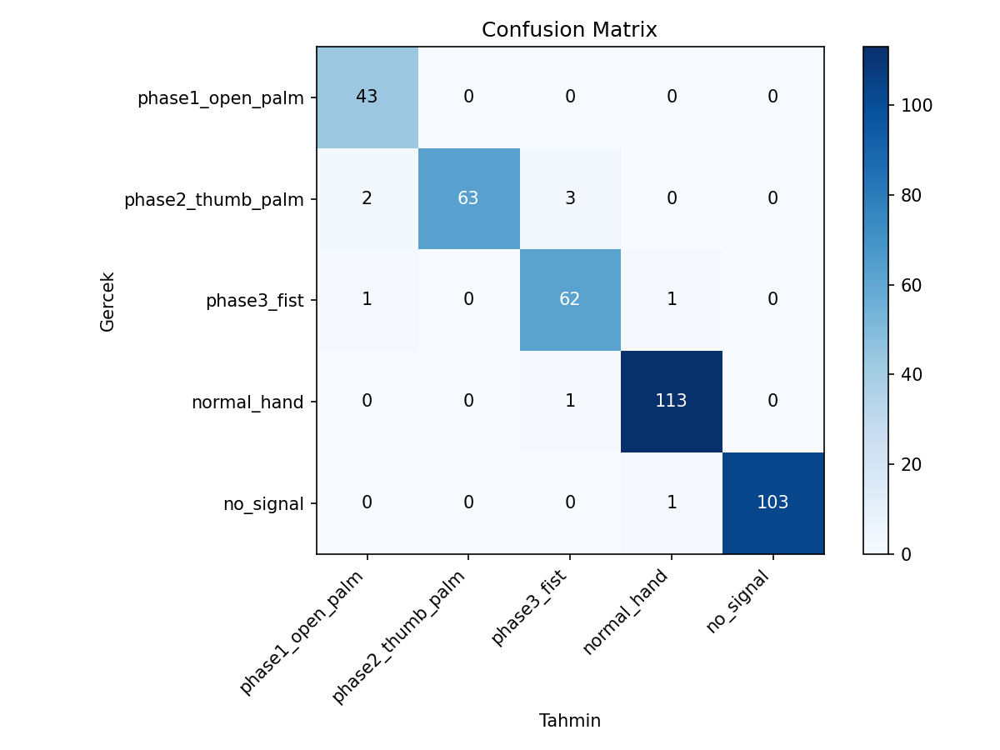

# HelpHand: El İşaretiyle Yardım Çağrısı Tespiti

Kamera görüntüsünde uluslararası **"Signal for Help"** el işaretini (açık avuç → başparmak avuca → parmaklar başparmağın üzerine kapanır) gerçek zamanlı olarak tanıyan ve işaret tamamlandığında alarm üreten bir derin öğrenme sistemi.

## Yaklaşım

- **El tespiti:** MediaPipe Hands, 21 eklem noktası (x, y, z) ve el bölgesi kırpması.
- **Sınıflandırıcı (iki dallı füzyon ağı, PyTorch):**
  - Görüntü dalı: MobileNetV3-Small (ImageNet ön eğitimli).
  - Landmark dalı: 63 boyutlu eklem vektörü için MLP.
  - Füzyon katmanı: 5 sınıf (`phase1_open_palm`, `phase2_thumb_palm`, `phase3_fist`, `normal_hand`, `no_signal`).
- **Sonlu durum makinesi (FSM):** Üç aşamanın doğru sırada ve zaman penceresi içinde gelmesi gerekir. Tek karelik yanlış tahminler alarm üretmez.
- **Veri artırma:** Albumentations ile döndürme, parlaklık/kontrast, bulanıklık ve gürültü.
- **Eğitim:** AdamW, AMP, erken durdurma (patience 15).

## Sonuçlar (test seti, 393 görüntü)

| Sınıf | Precision | Recall | F1 |
|---|---|---|---|
| phase1_open_palm | 0.93 | 1.00 | 0.97 |
| phase2_thumb_palm | 1.00 | 0.93 | 0.96 |
| phase3_fist | 0.94 | 0.97 | 0.95 |
| normal_hand | 0.98 | 0.99 | 0.99 |
| no_signal | 1.00 | 0.99 | 1.00 |
| **Genel doğruluk** | | | **0.977** |



## Klasör yapısı

```
config/       config.yaml (model, eğitim, veri artırma, FSM ayarları)
dataset/      webcam ile veri toplama (generator.py), hazırlama ve artırma
models/       hand_detector, gesture_classifier (füzyon ağı), gesture_fsm, distress_detector
training/     train.py, evaluate.py, callbacks.py
inference/    gerçek zamanlı kamera, tespit ve alarm
checkpoints/  best_model.pth (eğitilmiş model)
data/splits/  train / val / test ayrımı
```

## Çalıştırma

```bash
pip install -r requirements.txt
python main.py --mode detect --source 0            # webcam ile gerçek zamanlı tespit
python main.py --mode prepare                      # veri hazırlama
python main.py --mode train                        # eğitim
python main.py --mode evaluate --model checkpoints/best_model.pth
```

**Veri notu:** Eğitim verisi (5 sınıfta 2.623 görüntü) `dataset/generator.py` ile webcam üzerinden toplandı. Kişisel görüntüler içerdiği için repoya eklenmedi; aynı araçla yeniden toplanabilir.
